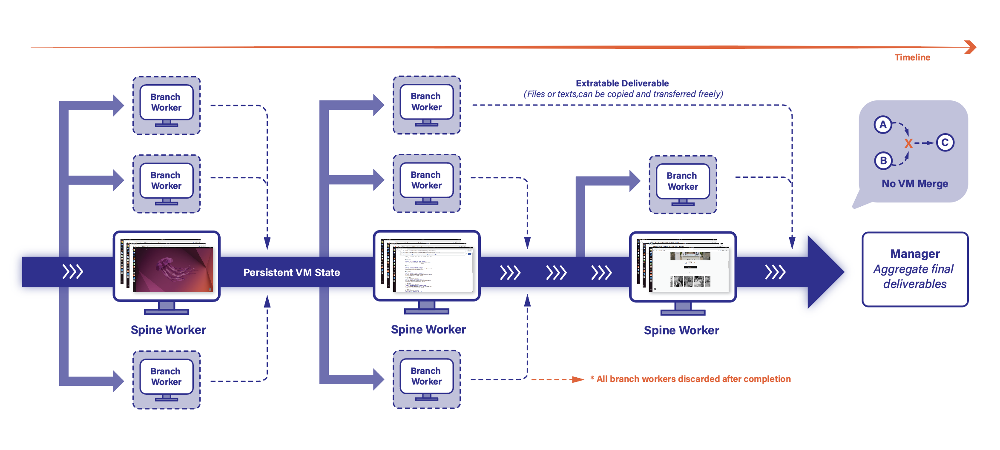

# Spine-Branch Coordination for Multi-agent Computer Use

Code for the paper **"Spine-Branch Coordination for Multi-agent Computer Use."**

Computer-use agents (CUAs) are increasingly deployed as multi-agent systems that decompose a task
into subtasks executed across parallel virtual machines (VMs). A critical **physical bottleneck** is
that the state of two VMs cannot be merged. **Spine-Branch** makes this an explicit planning
constraint — *single-parent VM inheritance*:

- a **spine** of workers carries the main task flow with continuous VM state (each node clones the
  previous node's VM), and
- **branch** workers run in parallel on fresh or cloned VMs, return extractable artifacts, and are
  **discarded** once finished — so no VM is ever merged.

On 200 long-horizon tasks from Odysseys across three CUA backbones, Spine-Branch improves success
rate over MACU by **6.0%–16.5%** while cutting per-task cost by **34%–70%** and manager-token
overhead by roughly **5×**.

[Paper (arXiv)](https://arxiv.org/abs/XXXX.XXXXX) · [Project website](https://mianzhang.github.io/spine-branch-computer-use/)



## Repository layout

```
spine-branch-computer-use/
├── run_spine_branch.py      # Spine-Branch executor (subclasses the MACU runner)
├── run_macu.py              # MACU / single-agent runner reused for baselines
├── prompts/                 # planner + manager prompts (spine_branch_decompose.yaml, ...)
├── utils/                   # runtime, graph, VM/init_from, and spine_branch/ coordination logic
├── scripts/
│   ├── lib/                 # benchmark launch helpers (run_odysseys.sh, ...)
│   ├── spine_branch/        # spine-branch run helpers
│   ├── generate_demo.py     # render an animated HTML/GIF demo from a real trajectory
│   ├── demo_to_video.py     # rasterize a demo HTML to GIF/MP4
│   ├── analyze_run.py / analyze_task.py / compare_runs.py / plot_*.py
│   └── experiments/         # per-benchmark reproduction launchers (odysseys, osworld_v2, ...)
├── evals/                   # offline judges for completed run directories
├── osworld/                 # local OSWorld patches / agent shims
├── tests/
├── requirements.txt
└── LICENSE
```

Large or private artifacts are intentionally **not** tracked: run outputs (`runs/`), benchmark data
(`data/`), VM images and overlays (`osworld_vms*/`, `apptainer/`), caches, logs, and the project
website. See `.gitignore`.

## Setup

Python 3.12 (for the OSWorld / torch stack). You also need an OSWorld checkout and a configured VM
provider (`apptainer`/QEMU or `vmware`) for real CUA runs.

```bash
uv venv --python python3.12 .venv
source .venv/bin/activate
uv pip install -r requirements.txt

cp .example_env .env      # then fill in provider endpoints / API keys
```

Set API keys and provider endpoints in `.env` (`OPENAI_API_KEY`, `ANTHROPIC_API_KEY`,
`GEMINI_API_KEY`, `OSWORLD_ROOT`, VM-provider paths, etc.). Benchmark task files
(Odysseys, OSWorld 2.0) are obtained from their upstream releases and dropped into `data/`.

## Quick start

`run_spine_branch.py` reuses MACU's CLI and adds spine-branch semantics. The **manager model plans
the spine-branch graph once**; `--max-replans` is ignored.

```bash
source .venv/bin/activate
set -a && source .env && set +a

python run_spine_branch.py data/odysseys/odysseys.json \
  --result-dir runs/odysseys_spinebranch_qwen37plus \
  --osworld-root "$OSWORLD_ROOT" \
  --manager-provider anthropic --manager-model claude-opus-4-8 \
  --cua-provider qwen \
  --max-parallelism 6 \
  -- --headless --provider_name apptainer \
     --model fireworks_ai/qwen3p7-plus --max_steps 60 --step_budget_awareness
```

- **Manager / planner:** `--manager-model` (e.g. `claude-opus-4-8`).
- **CUA backbone:** everything after `--` is passed to the CUA subprocess (`--model`, `--max_steps`,
  `--step_budget_awareness` for step-budget prompting).
- **Single task:** add `--task-id <id>` to run one task from a larger file.

For a fair single-agent baseline, run the same task file through `run_macu.py` with no manager and no
decomposition (see `scripts/experiments/`).

### Reproducing the paper

Per-benchmark launchers live in `scripts/experiments/`:

| Benchmark | Directory |
| --- | --- |
| Odysseys (main results, 200 tasks) | `scripts/experiments/odysseys/` |
| OSWorld 2.0 (decomposable subset) | `scripts/experiments/osworld_v2/` |
| WebTailBench / BrowseComp | `scripts/experiments/webtailbench/`, `browsecomp/` |

Each launcher sets the backbone, step budget, and result dir, then calls the shared helpers in
`scripts/lib/`.

## Evaluation

Score a completed run directory with the offline judges in `evals/` (Odysseys uses a rubric judge;
OSWorld 2.0 is graded programmatically). See `evals/README.md` for options; we score Odysseys with
`gemini-3.1-flash-lite`.

## Demos

`scripts/generate_demo.py` turns a real Spine-Branch run into a self-contained animated HTML (and
`scripts/demo_to_video.py` renders it to a looping GIF):

```bash
python scripts/generate_demo.py RUN_DIR TASK_ID -o demo.html --hide-task
python scripts/demo_to_video.py demo.html -o demo --gif-width 1250
```

Rendered demos and the project page are published on the website (deployed separately from this repo).

## Citation

```bibtex
@article{zhang2026spinebranch,
  title   = {Spine-Branch Coordination for Multi-agent Computer Use},
  author  = {Zhang, Mian and Sharma, Manasi and Zhang, Sheng and Yang, Minlai
             and Shi, Kejian and Liu, Ying and Chen, Zhiyu Zoey and Zhang, Daniel Yue},
  year    = {2026}
}
```

## Acknowledgements

Spine-Branch builds on the **MACU** (Multi-Agent Computer Use) codebase — `run_spine_branch.py`
subclasses MACU's runner and reuses its worker loop, VM/`init_from` machinery, and result capture.
We also build on [OSWorld](https://os-world.github.io/) and evaluate on OSWorld 2.0 and the Odysseys
benchmark. We thank the authors of those projects.

## License

See [LICENSE](LICENSE).
